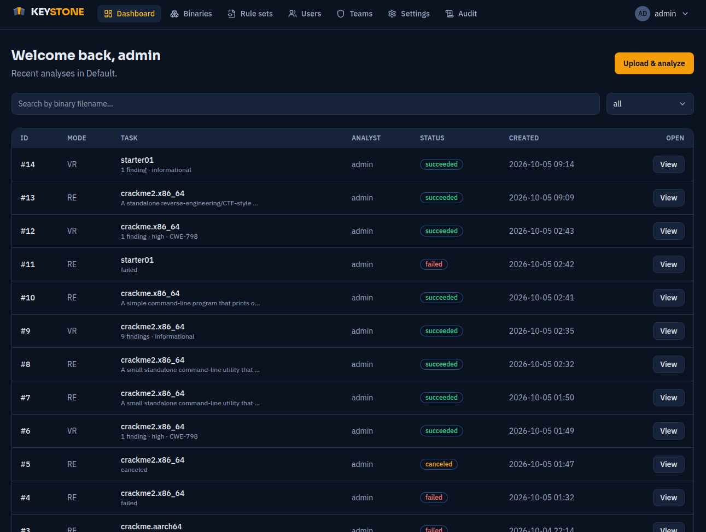

# Keystone

Multi-user, self-hostable web application for **AI-assisted reverse engineering &
vulnerability research**, built on `ghidra-headless-mcp`.

**Status: Keystone v1 (M1–M7 complete).** Per-analysis Semgrep rule sets (M6) and
model-suggested function names (M7) followed v1 — see their sections below.
A secure, observable, fully-tested and
deployable multi-user app: JWT auth + API tokens, users/teams/RBAC, admin system-
settings and the branded React shell; both analysis paths end-to-end (RE: upload ->
async analysis -> live Steps -> report; VR: pick rule sets -> Semgrep -> interactive rule pick ->
triage + reachability); the review layer (searchable team-scoped history, MD/JSON/
PDF export, team switcher, admin audit log, in-app notifications); and hardening —
rate limiting, security headers, `/readyz` + `/metrics`, an 80%-gated test suite
with `make ci`, a one-command TLS production deploy (see `docs/deployment.md`), and defence in
depth against prompt injection in the analyzed binaries — an authenticated MCP
server, a two-stage injection-resistant analyzer, and a ⚠ flag to the reviewer
(see `docs/security.md`). Errors are handled end-to-end — a global JSON error
handler, worker-side failure capture, traceback logging, `/metrics` error
counters, and a frontend error boundary (see `docs/observability.md`).
Everything is test-gated and comes up with one command.



## Quick start (everything in Docker Compose)

No host Python or Node is required — every service runs in a container, with
source bind-mounted for hot reload.

### 1. Set up ghidra-headless-mcp first

Keystone's Ghidra backend is `ghidra-headless-mcp`, a separate, standalone service.
Keystone does not start it and shares nothing with it — no files, no Docker
network. The worker reaches its plain HTTP API (the `--http` service's `/api`)
by URL only, and sends each binary to it as raw bytes when an analysis runs; the
server imports it and discards the upload in the same request. Keystone's own copy
stays in its object store.

In `ghidra-headless-mcp`: set `GHMCP_API_KEY` in its `.env` and start it
(`docker compose up -d` starts the `--http` service on 1351). Its
`MAX_STREAM_UPLOAD_BYTES` (128 MiB by default) must be at least Keystone's
`KEYSTONE_UPLOAD_MAX_BYTES` (100 MiB by default). Then, here, in `infra/.env`:

- `KEYSTONE_MCP_API_KEY` — the **same** key.
- `KEYSTONE_MCP_ENDPOINT` — where the worker reaches it. The default,
  `http://host.docker.internal:1351/api`, is its published `--http` port on the
  Docker host; change the port if it publishes on another one (its
  `GHMCP_HTTP_PORT`).

### 2. Start Keystone

```bash
./run-dev.sh       # core stack + migrations + admin + a fake-engine worker
./run-dev.sh --real-engine   # a worker that calls ghidra-headless-mcp and a live LLM
make up            # or: the core stack only, in the foreground (`make down` to remove)
```

`run-dev.sh --real-engine` checks that `KEYSTONE_MCP_API_KEY` is set.

Then open **http://localhost:8080** and sign in with the first-run admin:

| | |
|---|---|
| Username | `admin` |
| Password | `change-me` |

Change these before any real deployment (see **Configuration**). The admin, the
`Default` team, and the settings singleton are created automatically on first
boot (idempotent bootstrap); re-running never duplicates them.

### Services & ports (all behind nginx on :8080)

| URL / port | Service |
|---|---|
| http://localhost:8080 | Frontend (Vite dev server, proxied) |
| http://localhost:8080/api | Backend REST API (Flask) |
| http://localhost:8080/api/healthz | Liveness probe |
| postgres:5432 | PostgreSQL 16 (internal) |
| redis:6379 | Redis 7 (internal; Celery job queue + progress pub/sub) |
| s3:7070 | S3 object storage — VersityGW (internal) |
| host.docker.internal:1351/api | the Ghidra backend (`KEYSTONE_MCP_ENDPOINT`) — **not part of this stack**: a separate service the worker reaches by URL |

## Configuration

All config is environment-driven with the `KEYSTONE_` prefix (pydantic-settings).
Copy the template and edit:

```bash
cp infra/.env.example infra/.env
```

Secrets to change for production:

- `KEYSTONE_JWT_SECRET` — signs access tokens; use a long random value.
- `KEYSTONE_ADMIN_PASSWORD` — the first-run admin password.
- `POSTGRES_PASSWORD` / `KEYSTONE_S3_SECRET_KEY`.
- `KEYSTONE_LLM_API_KEY` — the LLM endpoint key. It is a **deployment secret**:
  Keystone never stores it in the database. The admin sets the LLM *endpoint URL*
  and *default model* at runtime under **Settings**; the key stays in the
  environment and the UI only shows whether one is configured.
- `KEYSTONE_TRIAGE_API_KEY` — optional key for a separate, cheaper **triage**
  model (the two-model cascade). Blank ⇒ triage reuses the analysis model/key.
  See `docs/models.md`.

## Semgrep rule sets

The patterns a VR analysis scans decompiled code with are **chosen per analysis**,
from a library shared at team level.

- **Rule sets** live under **Rule sets** in the nav. A ruleset is a Semgrep
  `rules:` YAML document stored in the database — no registry fetch, no network
  egress from the worker.
- Two tiers. A **built-in** (`team_id IS NULL`) ships with Keystone, is readable by
  every team, and is writable only by admins; a team **clones** one to customize it.
  A **team rule set** is created and edited by any analyst on that team.
- **Versions are immutable.** Saving appends `v2`; `v1` is never rewritten. An
  analysis pins the exact versions it ran, so a six-month-old finding can still be
  explained by the rule text that produced it. The analysis page names them.
- **Run VR** opens a picker: choose one or more rule sets (the deployment default
  from **Settings → Default rule set** is preselected), and optionally keep the
  mid-run pause that picks a *rule class* to triage. The two are different
  questions — rule sets are "what do we look for", the class pick is "of what we
  found, what gets LLM budget".
- Content is validated on save (structure, rule ids, severities, size caps) and
  a rule's `message` is screened for prompt injection, since it reaches the triage
  model. See [`docs/security.md`](docs/security.md).

The shipped ruleset lives at `backend/semgrep-rules/decompiled-c.yaml` and is
seeded as the built-in by the idempotent bootstrap; changing that file appends a
new version on the next boot rather than duplicating the rule set.

### Vendored third-party rules

[0xdea/semgrep-rules](https://github.com/0xdea/semgrep-rules) (MIT) — 50 curated
C/C++ vulnerability-research rules — is vendored under
`backend/semgrep-rules/0xdea/`, pinned to a commit, and seeded as **five** further
built-ins grouped by upstream's own `vulnerability_class`:

| Rule set | Rules |
|---|---|
| `0xdea · Memory safety (C/C++)` | 20 |
| `0xdea · Dangerous functions (C/C++)` | 9 |
| `0xdea · Correctness & control flow (C/C++)` | 10 |
| `0xdea · Privilege, secrets & crypto (C/C++)` | 8 |
| `0xdea · Recon & noisy (C/C++)` | 3 |

The last is separated because it is high-volume by design — on a 114-function
decompiled corpus those three rules produced 87 of 92 findings. Opt into it when
orienting on an unfamiliar binary, not when hunting a specific bug class.

**Credit is displayed, not just filed.** Each imported rule set carries an
`attribution` record — author, licence, upstream URL and pinned commit — shown as a
byline in the library and in the Run VR picker, and copied onto a clone (forking
somebody's rules does not make them yours). Rule sets authored in Keystone carry
none.

Exported reports carry it too: every export (Markdown, PDF, JSON) opens with a
`## Rule sets` block naming the exact versions the scan ran and who wrote them, and
the JSON bundle repeats it as structured `rule_sets` data. An export is the
redistributed artifact, so the notice goes with it.

Nothing is fetched at runtime: the tree is vendored, the grouping lives in
`keystone_api/rule_import.py`, and seeding goes through the same idempotent
`upsert_builtin_ruleset` path. To move to a newer upstream commit, follow
`backend/semgrep-rules/0xdea/UPSTREAM.md` — a changed rule appends a version to
just the group that carries it.

## Function names

Ghidra calls an unrecognised function `FUN_1c0026f90`. Keystone has a model read
the decompiled body and propose a name and a one-line purpose, then lets you choose
which functions the report shows.

- **Named during the run**, because RE's decompiled code lives in an in-process
  cache that dies with the task. RE names the 8 functions it decompiled; VR names
  the functions behind the findings you triaged (capped at 50 — it decompiles
  every function, and samples run to thousands).
- **Picked after the run.** The Functions panel on an analysis has a checkbox per
  function; the report re-renders on the next read. There is no artifact to
  regenerate, so it can never be stale.
- **The Ghidra symbol always shows** beside the friendly name, in the UI and in
  every export. A suggested name comes from a model reading attacker-controlled
  code; it is a reading aid, never the identity.
- **Edit a name by hand** and it is marked `source='user'`, which the naming pass
  skips from then on — a re-run never undoes a correction.
- **Nothing is written back into Ghidra.** One project holds every team's programs,
  so a rename there would cross the team boundary Keystone enforces in Postgres.

Naming rides the cheaper triage model when one is configured, and a naming failure
never fails an analysis — the run completes with `FUN_` addresses.

## Testing

```bash
make test          # backend (pytest) + frontend (vitest), both in-container
make test-be       # backend only  — pytest
make test-fe       # frontend only — vitest
make lint          # ruff/black/mypy + eslint/tsc
```

End-to-end (Playwright, against a running stack):

```bash
make up            # in one terminal
make e2e           # in another — drives the full M1 flow in a headless browser
```

The e2e proves M1–M4: M1 (login → provision analyst + team → settings), M2 (upload
→ run RE → Steps → report → history), M3 (run VR → pick a rule class → triage +
reachability) and M4 (cross-user collaboration → search → export → audit). M2–M4
need the worker running the deterministic fake engine (no Ghidra/LLM/Semgrep):

```bash
make up            # in one terminal
make engine-fake   # start the worker in fake-engine mode
make e2e           # runs both m1 and m2 specs
```

## Admin bootstrap & seeding

```bash
make bootstrap     # ensure settings + Default team + admin (idempotent)
make seed          # dev fixture: bootstrap + a demo analyst in a demo team
make migrate       # apply Alembic migrations to head
```

`make up` already applies migrations and bootstraps on start; these targets are
for re-running against an existing stack.

## Layout

```
backend/    Flask API (keystone_api) — app factory, SQLAlchemy models, Alembic
            migrations, auth (JWT + refresh + API tokens), RBAC, users/teams/
            settings APIs. pytest suite under tests/.
frontend/   React + TypeScript (Vite). Design system (Tailwind + Keystone tokens,
            Radix components), auth context + protected routing, admin/settings
            UI. Vitest + RTL unit tests; Playwright e2e under e2e/.
infra/      docker-compose.yml, nginx reverse proxy, .env.example, smoke.sh
```

Built stage by stage; each stage is test-gated and committed independently.

## License

Copyright 2026 Andrei Dimitrief-Jianu. Licensed under the
[Apache License, Version 2.0](LICENSE).

The vendored Semgrep rules in `backend/semgrep-rules/0xdea/` are third-party work
under their own MIT licence, kept beside them in that directory.
